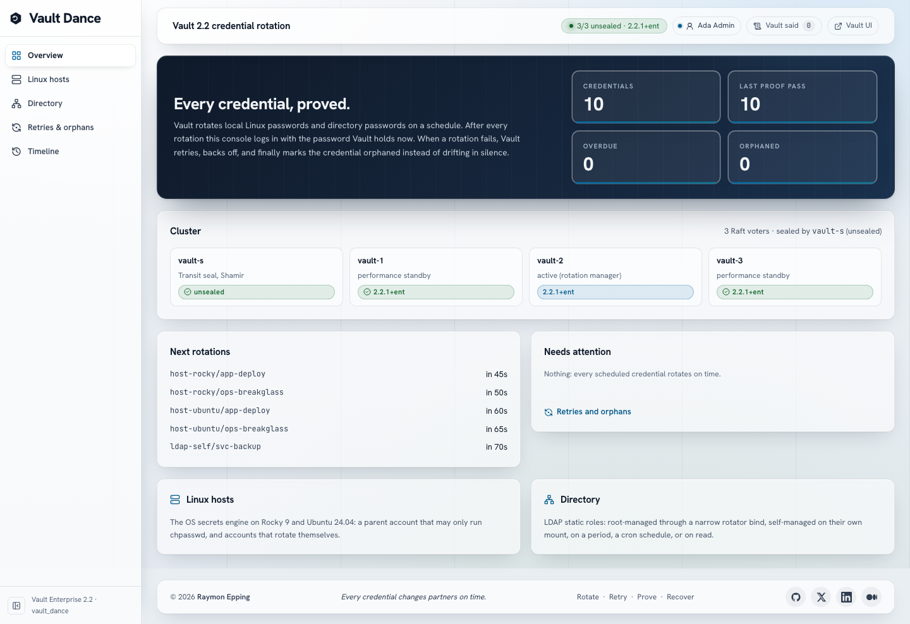

# vault_dance

A Vault Enterprise 2.2 lab for **automated credential rotation of accounts
that live outside Vault**: local Linux passwords through the OS secrets
engine, and directory passwords through LDAP static roles, root-managed and
self-managed. Rotations run on periods, cron schedules or on read; rotation
policies decide how long Vault retries a failing rotation before it stops and
lists the credential as orphaned. A console proves every credential by
logging in with the password Vault holds right now.

Everything runs on one Mac: Podman (compose), Make, Terraform and Ansible.



## What it shows

| Area | Vault feature | What you see |
| --- | --- | --- |
| Linux hosts | OS secrets engine (`vault-plugin-secrets-os` 0.2.2+ent) on Rocky 9 and Ubuntu 24.04 | `mgmt-vault` may run one command as root (`chpasswd`) and rotates `app-deploy`; `ops-breakglass` and `mgmt-vault` rotate themselves with `passwd` over a PTY. Host keys pinned, never trusted on first use. |
| Directory | LDAP static roles on OpenLDAP | Root-managed through a bind that may only write service-account passwords: a period (`svc-billing`), rotate on read with a cooldown (`svc-reports`), a cron schedule (`svc-batch`). Self-managed on its own mount (`svc-backup`). Health checks; unlock refused (Active Directory only). |
| Failure | Rotation policies, `sys/rotation/orphans` | A broken target, retries with growing backoff, an orphan, the fix, a re-register, green again. |
| Platform | vault-s + three-node Raft cluster | Transit auto-unseal with one seal token per node, TLS 1.3 everywhere, no root token after bootstrap. |
| People | LDAP auth and Keycloak (OIDC to the console) | `tess` sees, `otto` acts, `ada` administers; Vault decides, the console shows its answer verbatim. |

## What it proves, and what it does not

It proves the mechanics: parent-managed and self-managed rotation on two
distributions, root-managed and self-managed LDAP roles, schedules, rotate on
read, retry and orphan behaviour, and that a temporary outage never locks an
account out. Measured on 2.2.1 (`docs/capabilities.md`):

- An LDAP static role follows its rotation policy and is orphaned within
  minutes. **An OS account stores its rotation policy but does not apply it**
  (plugin 0.2.2+ent): it keeps retrying with Vault's default backoff and is
  never orphaned.
- **An orphan record stays** in `sys/rotation/orphans` after the fix, so the
  console calls a credential orphaned only when it is listed and overdue.
- The OS secrets engine documents RHEL (shadow-utils newer than 4.6) as its
  platform. Ubuntu 24.04 worked in every test here, but it is outside that
  line.

It only illustrates scale and Active Directory: OpenLDAP is not AD (account
unlock is AD-only), and two hosts are not a fleet. HashiCorp positions local
account rotation for a narrow class of accounts (break-glass, local admin),
not as a replacement for central identity.

## Requirements

- macOS on Apple Silicon with a Podman machine (8 GiB or more for Podman),
  `podman compose`, Terraform 1.14+, Ansible core 2.21+ (collections
  `community.general`, `ansible.posix`), the `vault` CLI, `jq`, `openssl`,
  `sshpass`, Node 24+.
- A Vault Enterprise licence.
- Free host ports 18900 to 18903, 13600 to 13602, 13622 and 13623 (`make
  ports-check`; override them in `.env`).

## First run

```bash
make env-init            # creates .env; put the licence in VAULT_LICENSE
make license
make bootstrap           # zero to verified, about 10 minutes
make identity-copy-password U=ada
open https://localhost:13601/
```

`make trust-root` trusts the lab CA in the macOS keychain so the browser
accepts the console.

## Daily use

```bash
make up                  # unseals vault-s, starts everything
make down                # stops everything; data stays
make rotation-status     # every credential: schedule, last, next, state
make proof               # log in with every credential Vault holds now
make doctor              # what is wrong and which command fixes it
```

### Break-glass login

Log in to a host as a Vault-managed account with the password Vault holds
right now, read with **your** Vault login (operators only; a viewer is
refused by Vault before SSH starts). The password never appears on screen:

```bash
export VAULT_ADDR=https://127.0.0.1:18901 VAULT_CACERT=$PWD/vault-tls/ca-chain.pem
make identity-copy-password U=ada && vault login -method=ldap username=ada
make ssh HOST=rocky                          # ops-breakglass on host-rocky
make ssh HOST=ubuntu ACCOUNT=app-deploy      # or mgmt-vault
make ssh HOST=rocky CMD="id; hostname"       # one command instead of a shell
```

The read is in Vault's audit log under your name. Press **Rotate now** in the
console afterwards if the password you used should die at once.

## The demo

1. **Overview**: three nodes, one leader, sealed by `vault-s`; ten
   credentials, all proved.
2. **Linux hosts**: `app-deploy` rotates every two minutes; the fingerprint
   changes, the SSH proof stays green, on Rocky and on Ubuntu.
3. **Directory**: check out `svc-reports` twice inside the cooldown (same
   fingerprint), once after (a new one). Run a health check.
4. `make scenario-host-down`: Vault's failed attempts appear on the timeline
   with growing pauses. `make scenario-host-down-heal`: the password Vault
   holds still logs in (no lockout) and the next retry rotates it.
5. `make scenario-ldap-acl`: the rotator loses its write rule; `svc-billing`
   is orphaned within minutes while people still sign in.
   `make scenario-ldap-acl-heal` restores the rule and re-registers. Sign in
   as `tess` and try to re-register: Vault refuses.

The third scenario, `make scenario-password-age`, gives a self-managed account
a minimum password age, so `passwd` refuses. `docs/scenarios.md` has all
three with measured timings.

## Checks

```bash
make verify              # end to end: podman, vault, identity, hosts, rotation, app, drift
make test-unit           # API and console unit tests
make api-test            # every API route as tess, otto and ada
make test-ui             # Playwright, signed in through the real Keycloak form, axe
make rotation-test       # every scenario end to end; each case must heal (about 20 minutes)
make probe               # every Vault call the lab uses, on scratch mounts
make lint                # shellcheck, terraform fmt and validate, ansible-lint
```

## Where things are

| Path | What |
| --- | --- |
| `docs/PRD.md` | Requirements |
| `docs/architecture.md` | Topology, stacks, start order, seal tokens |
| `docs/security-model.md` | Identities, tokens, what each may do, lab limits |
| `docs/operations.md` | Every make target, recovery recipes |
| `docs/scenarios.md` | The three failure stories, measured |
| `docs/capabilities.md` | What Vault 2.2.1 answered (`make probe`) |
| `docs/STATE.md` | Build log and what was learned |
| `DESIGN.md` | The console's design rules (Vault daylight glass) |
| `config/defaults.conf` | Image pins, ports; override in `.env` |
| `config/credentials.json` | The ten credentials |

## Ports

| Port (127.0.0.1) | Service |
| --- | --- |
| 18900 | vault-s (seal Vault) |
| 18901, 18902, 18903 | vault-1, vault-2, vault-3 |
| 13600 | API |
| 13601 | Console (HTTPS) |
| 13602 | Keycloak |
| 13622, 13623 | SSH to host-rocky, host-ubuntu (Ansible only) |
